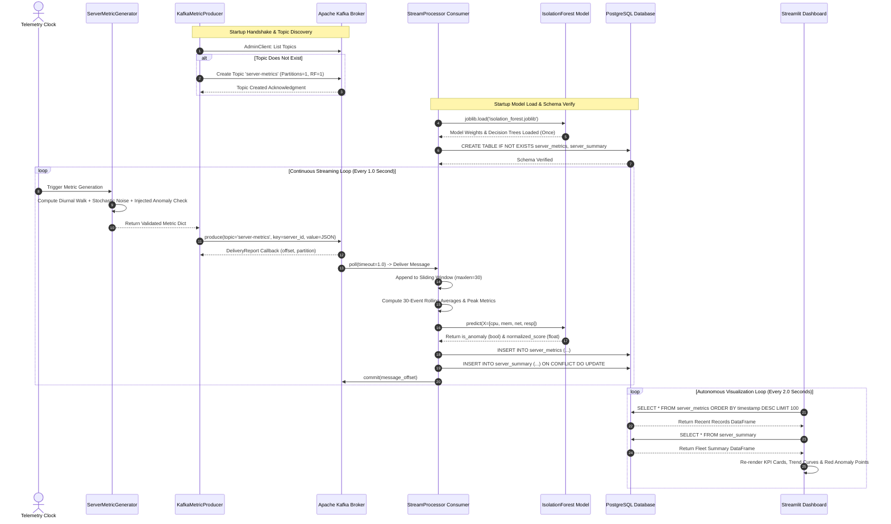
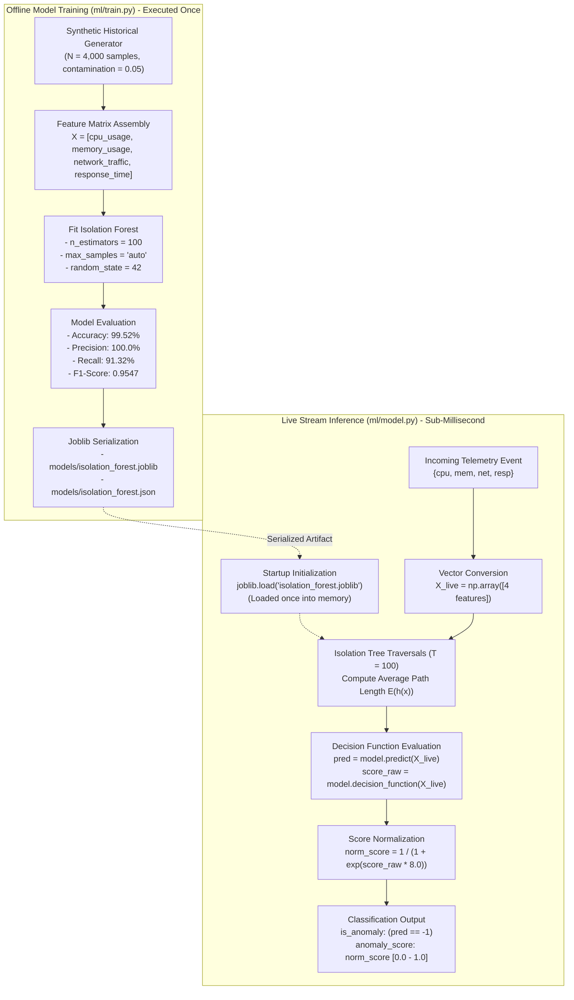
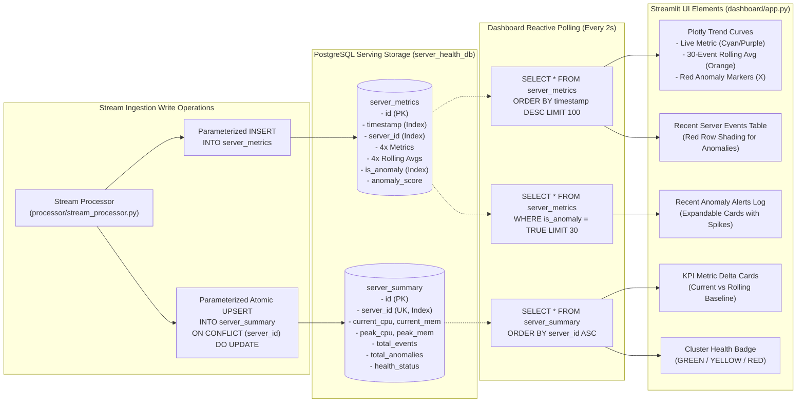

# Technical Architecture Specification

**Project Title:** Real-Time Server Health Monitoring and Anomaly Detection Using Apache Kafka and Machine Learning  
**Course:** Data Stream Analytics  
**Document Purpose:** In-depth architectural specification, component topology, and sequence interaction models.

---

## 1. System Overview

The system is designed around a decoupled, six-layer real-time streaming pipeline. The architecture ensures that each stage of the data lifecycle—generation, message transport, stateful stream processing, machine learning scoring, persistent storage, and visualization—operates independently with well-defined network boundaries.

---

## 2. Diagram 1: Overall System Architecture

The following diagram illustrates the deployment topology, physical container boundaries, and network relationships across all six layers:

```mermaid
flowchart TD
    subgraph Layer1["Layer 1: Data Source"]
        SMG["ServerMetricGenerator<br/>(producer/generator.py)<br/>- Diurnal Harmonic Modeling<br/>- Gaussian Noise Injection<br/>- 5 Anomaly Injection Modes"]
    end

    subgraph Layer2["Layer 2: Streaming Infrastructure"]
        KP["KafkaMetricProducer<br/>(producer/producer.py)<br/>Key = server_id<br/>Compression = Snappy"]
        KB[("Kafka Broker<br/>Topic: server-metrics<br/>Port: 9092 / 9094")]
        ZK["Apache Zookeeper<br/>Cluster Coordination<br/>Port: 2181"]
        ZK --- KB
    end

    subgraph Layer3["Layer 3: Stream Processing Engine"]
        KC["Kafka Consumer Client<br/>Group: server-health-processor-group"]
        SW["Sliding Window Buffer<br/>(collections.deque, maxlen=30 per server)"]
        RA["Rolling Analytics Calculator<br/>- Moving Averages (CPU, Mem, Net, Latency)<br/>- Historical Peak Utilization Tracking<br/>- Health Status Evaluation"]
    end

    subgraph Layer4["Layer 4: Machine Learning Inference"]
        MDL[("Trained Model Artifact<br/>models/isolation_forest.joblib<br/>(Loaded once at startup)")]
        INF["Inference Engine<br/>(ml/model.py)<br/>- Decision Function Scoring<br/>- Sigmoid Normalization [0.0 - 1.0]"]
    end

    subgraph Layer5["Layer 5: Persistent Serving Layer"]
        PG[("PostgreSQL 15 Database<br/>Database: server_health_db<br/>Port: 5432")]
        T1["Table: server_metrics<br/>- Raw Telemetry<br/>- Rolling Averages<br/>- Anomaly Flags & Scores"]
        T2["Table: server_summary<br/>- Current Node KPIs<br/>- Peak Historical Values<br/>- Total Anomalies Count"]
    end

    subgraph Layer6["Layer 6: Visualization Dashboard"]
        ST["Streamlit Web Server<br/>(dashboard/app.py)<br/>Port: 8501"]
        UI1["Live KPI Delta Cards"]
        UI2["Plotly Multi-Trace Trend Charts"]
        UI3["Red Anomaly Marker Highlights"]
        UI4["Fleet Health Status Matrix"]
    end

    SMG -->|Validated Event Dictionary| KP
    KP -->|Produce Binary Message| KB
    KB -->|Consume Event Stream| KC
    KC --> SW
    SW --> RA
    RA -->|4D Feature Vector| INF
    MDL -.->|Load Artifact Once| INF
    INF -->|Enriched Event Record| PG
    PG --> T1
    PG --> T2
    T1 -.->|SQL Query Polling (Every 2s)| ST
    T2 -.->|SQL Query Aggregations| ST
    ST --> UI1
    ST --> UI2
    ST --> UI3
    ST --> UI4
```

---

## 3. Diagram 2: End-to-End Data Flow

The following data flow diagram traces the transformation of an individual telemetry event as it moves from generation to persistent storage and visual presentation:

```mermaid
flowchart LR
    A["Raw Metric Generation<br/>{cpu, mem, net, resp}"] --> B["Validation & Clamping<br/>validate_metric()"]
    B --> C["JSON Serialization<br/>Partition Key = server_id"]
    C --> D["Kafka Broker Buffer<br/>Topic: server-metrics"]
    D --> E["Kafka Message Consumption<br/>consumer.poll()"]
    E --> F["Sliding Window Update<br/>deque.append(event)"]
    F --> G["Rolling Average Computation<br/>mean(last 30 events)"]
    G --> H["ML Feature Extraction<br/>X = [cpu, mem, net, resp]"]
    H --> I["Isolation Forest Scoring<br/>is_anomaly & anomaly_score"]
    I --> J["Health Status Evaluation<br/>HEALTHY / WARNING / CRITICAL"]
    J --> K["PostgreSQL Insertion<br/>INSERT INTO server_metrics"]
    J --> L["Summary Upsert<br/>ON CONFLICT DO UPDATE"]
    K --> M["Streamlit Polling Query<br/>SELECT ... ORDER BY ts DESC"]
    L --> M
    M --> N["Dashboard Render<br/>KPIs + Trend Curves + Red Points"]
```



---

## 4. Diagram 3: Producer-Consumer Interaction Sequence

The following sequence diagram illustrates the temporal coordination, connection handshakes, message transmission, and transaction commits between the producer, Kafka broker, stream processor, and database:



---

## 5. Diagram 4: Machine Learning Training and Inference Workflow

The following diagram details the separation of offline training from sub-millisecond live stream inference:



---

## 6. Diagram 5: Database Serving and Dashboard Interaction

The following diagram illustrates the interaction between the PostgreSQL persistent serving tables and the reactive Streamlit visualization engine:



---

## 7. Architectural Decisions and Engineering Rationale

1. **Why Kafka Over Direct HTTP / REST Pushing:**
   Direct HTTP ingestion between data sources and processors introduces tight coupling, connection overhead, and failure cascades during burst traffic. Kafka acts as a shock absorber, persisting incoming messages into a distributed write-ahead log that decouples ingestion rates from downstream processing capacity.
2. **Why Sliding Window of 30 Events:**
   In server infrastructure monitoring, instantaneous scalar metrics exhibit high Gaussian variance. A sliding window of 30 events provides sufficient temporal smoothing to filter out high-frequency transient spikes while responding rapidly to sustained operational drift.
3. **Why Isolation Forest for Anomaly Detection:**
   Traditional density-based algorithms (such as DBSCAN or LOF) exhibit $O(n^2)$ computational complexity, making them unsuitable for live stream scoring. Isolation Forest scales linearly at $O(T \cdot \log n)$, requiring only simple tree traversals during inference, achieving sub-millisecond scoring latencies ($< 0.4 \text{ ms}$).
4. **Why PostgreSQL as the Serving Layer:**
   The Streamlit dashboard requires complex relational aggregations, filtering by server ID, reverse chronological sorting, and atomic summary upserts. PostgreSQL provides ACID compliance, battle-tested B-tree indexing, and standard SQL interfaces.
